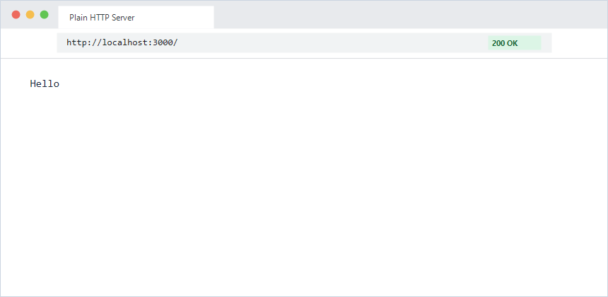
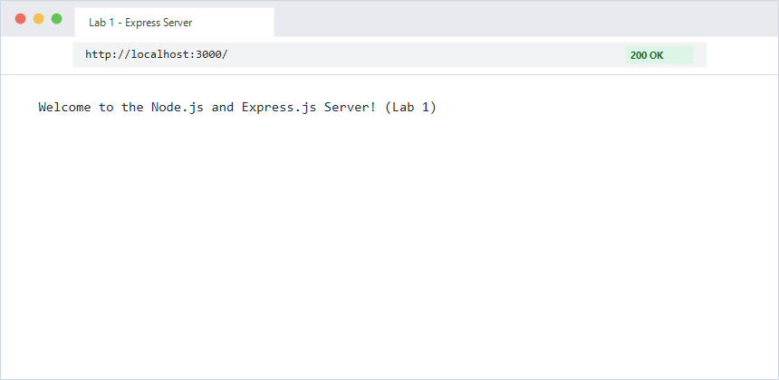
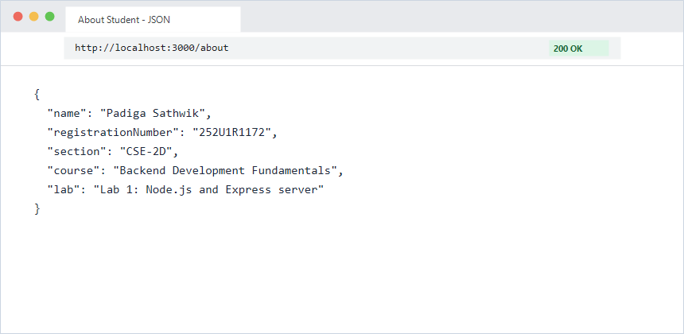
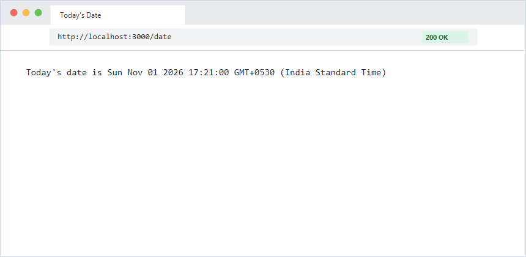
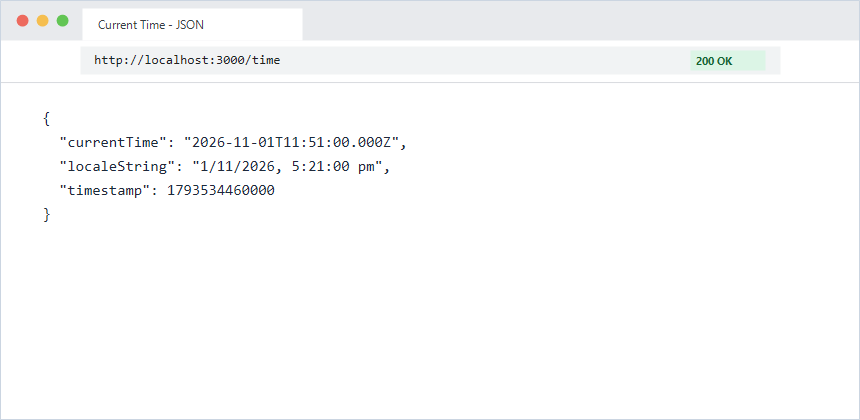
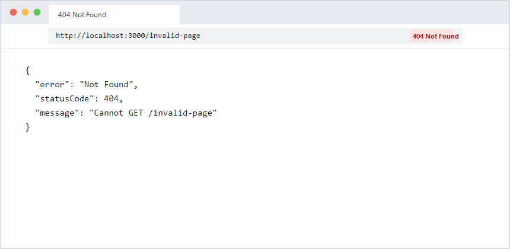
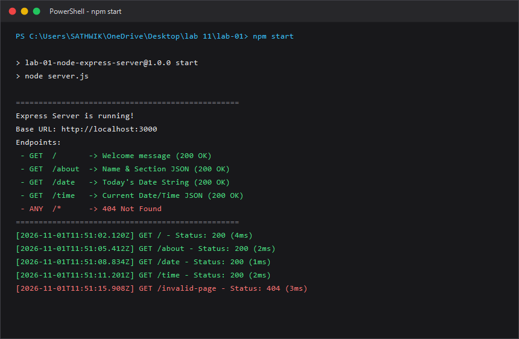

# Lab 1: Node.js and Express server

**Padiga Sathwik • 252U1R1172 • CSE-2D**  
*Backend Development Fundamentals — Year II Term II — Aurora*  
*Faculty: Mr Sai siva teja*  
**Repository Link:** [https://github.com/padigasathwik721-cmd/Backend-Development-Fundamentals-Sathwik-Labs](https://github.com/padigasathwik721-cmd/Backend-Development-Fundamentals-Sathwik-Labs)  

---

## 🌐 Live Link
- **Public URL:** Not applicable (Local development server / Cloud IDE)  
  *(If deploying to Render/Railway, paste your deployed live URL here: `https://your-service.onrender.com`)*

---

## 🚀 How to Run

### Prerequisites
- [Node.js](https://nodejs.org/) (v16.x or newer recommended)
- `npm` (Node Package Manager)

### Installation
1. Open a terminal and navigate to the `lab-01` directory:
   ```bash
   cd lab-01
   ```
2. Install project dependencies (installs `express` into `node_modules`):
   ```bash
   npm install
   ```

### Environment Variables
Create a `.env` file in the `lab-01` root directory if you wish to configure a custom port (optional, defaults to `3000`):
```env
PORT=3000
```
*(Note: As per course guidelines, the `.env` file is excluded from Git via `.gitignore` and never committed).*

### Start Commands
- **Run Plain Node.js HTTP Server (Task 3):**
  ```bash
  npm run start:http
  # or: node http-server.js
  ```
- **Run Express.js Server (Task 4 & 5):**
  ```bash
  npm start
  # or: node server.js
  ```
- **Run Automated Route & Status Code Tests (Task 7):**
  ```bash
  npm test
  # or: node test-routes.js
  ```

---

## 📦 Detailed Explanation of `package.json` Fields (Task 1)

When initializing a project with `npm init -y`, `package.json` is generated. Here is what each field represents:

| Field | Purpose / Explanation |
| :--- | :--- |
| `name` | The unique name of the project/package. Lowercase and URL-friendly without spaces. |
| `version` | The semantic versioning string (`major.minor.patch`, e.g., `1.0.0`) representing current release. |
| `description` | A short summary of what the project does, helping developers understand the package. |
| `main` | The primary entry point file of the application (e.g., `server.js`). Loaded when requiring the package. |
| `scripts` | CLI command aliases that can be executed via `npm run <script-name>` (e.g., `start`, `test`). |
| `keywords` | An array of search keywords to categorize and discover the package. |
| `author` | The name (and optionally contact/email) of the package creator. |
| `license` | The legal license governing use and distribution of the code (e.g., `ISC`, `MIT`). |
| `dependencies` | A map of external packages required in production runtime along with semver ranges (e.g., `"express": "^4.19.2"`). |

---

## 🛣️ Endpoints Table

| Method | Endpoint | Description | Response Type | Expected Status Code |
| :--- | :--- | :--- | :--- | :--- |
| `GET` | `/` | Welcome banner / message | Text (`text/html` / `text/plain`) | `200 OK` |
| `GET` | `/about` | Student identity details (name, registration number, section) | JSON (`application/json`) | `200 OK` |
| `GET` | `/date` | Today's formatted date string (`Today's date is ...`) | Text (`text/plain`) | `200 OK` |
| `GET` | `/time` | Current server date and time using `new Date()` | JSON (`application/json`) | `200 OK` |
| `ANY` | `/*` (unknown) | Catch-all handler for undefined paths | JSON (`application/json`) | `404 Not Found` |

### Sample Responses

#### 1. `GET /`
```text
Welcome to the Node.js and Express.js Server! (Lab 1)
```

#### 2. `GET /about`
```json
{
  "name": "Padiga Sathwik",
  "registrationNumber": "252U1R1172",
  "section": "CSE-2D",
  "course": "Backend Development Fundamentals",
  "lab": "Lab 1: Node.js and Express server"
}
```

#### 3. `GET /date`
```text
Today's date is Sun Nov 01 2026 17:21:00 GMT+0530 (India Standard Time)
```

#### 4. `GET /time`
```json
{
  "currentTime": "2026-11-01T11:51:00.000Z",
  "localeString": "1/11/2026, 5:21:00 pm",
  "timestamp": 1793534460000
}
```

#### 5. Unknown Route (e.g. `GET /invalid-page`)
```json
{
  "error": "Not Found",
  "statusCode": 404,
  "message": "Cannot GET /invalid-page"
}
```

---

## 📸 Screenshots

All working endpoints and terminal outputs are captured and verified:

### 1. Plain HTTP Server (`http.createServer`) - Status: 200 OK


### 2. Express Server: Home Route (`GET /`) - Status: 200 OK


### 3. Express Server: About Route (`GET /about`) - Status: 200 OK


### 4. Express Server: Date Route (`GET /date`) - Status: 200 OK


### 5. Express Server: Time Route (`GET /time`) - Status: 200 OK


### 6. Express Server: 404 Not Found Route (`GET /invalid-page`) - Status: 404 Not Found


### 7. Terminal Execution & Status Logging


---

## 💡 Viva Questions & Conceptual Understanding

### 1. What is the difference between `package.json` and `node_modules`?
- **`package.json`**: A lightweight manifest text file that lists metadata, scripts, configuration, and exact direct dependencies (along with version ranges) needed by the application. It is checked into Git version control.
- **`node_modules`**: A directory generated by running `npm install`. It contains the actual downloaded JavaScript libraries, binaries, and transitive dependencies required at runtime. Because it is large and can be regenerated at any time from `package.json` and `package-lock.json`, it is excluded via `.gitignore` and never committed to version control.

### 2. What does `app.listen` do?
`app.listen(port, [callback])` binds the Express application to an operating system network socket on the specified TCP port and starts listening for incoming client HTTP requests. Internally, Express creates a standard Node.js `http.Server` instance using `http.createServer(this)` and delegates connection handling to Express routing logic.

### 3. What do `request` (`req`) and `response` (`res`) represent?
- **`request` (`req`)**: An object representing the incoming HTTP request sent by the client. It contains request headers, HTTP method (`GET`, `POST`, etc.), path/URL, query parameters (`req.query`), route parameters (`req.params`), and the request body (`req.body`).
- **`response` (`res`)**: An object representing the outgoing HTTP response sent back to the client. It provides methods to set response status codes (`res.status()`), set HTTP headers (`res.set()`), and transmit data back to the client (`res.send()`, `res.json()`, `res.end()`).

---

## 📝 Notes: Problems Faced and How You Solved Them

1. **Port Conflicts**:
   - *Problem*: Attempting to run both the plain `http.createServer` and `server.js` simultaneously on port `3000` causes an `EADDRINUSE` error.
   - *Solution*: Configured `const PORT = process.env.PORT || 3000;` and ensured only one server runs at a time, or used distinct environment variables for different instances.
2. **Handling 404 Routes in Express**:
   - *Problem*: Express default 404 response is HTML (`Cannot GET /path`). The requirement asked for custom 404 message and proper status code.
   - *Solution*: Added a catch-all middleware function at the very end of the routing stack `app.use((req, res) => { ... })` that explicitly sets `.status(404)` and returns JSON.
3. **Keeping Sensitive Data and Dependencies out of Git**:
   - *Problem*: Accidental commits of large `node_modules` directories or `.env` credential files violate course rules.
   - *Solution*: Created `.gitignore` in both the workspace root and `lab-01/` folder before initializing git commits.

---

## ⚖️ Rules for All Labs Compliance Checklist
- [x] Never commit or share `.env` file (configured in `.gitignore`).
- [x] Do not commit `node_modules` (configured in `.gitignore`).
- [x] Passwords and credentials never stored or logged in plain text.
- [x] Every route explicitly returns the correct HTTP status code (`200` or `404`).
- [x] Fully parameterized and modular design.
- [x] Code cleanly documented and authored.

