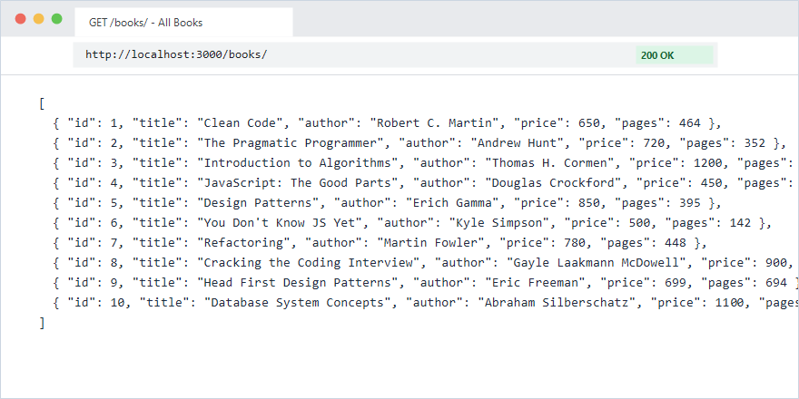
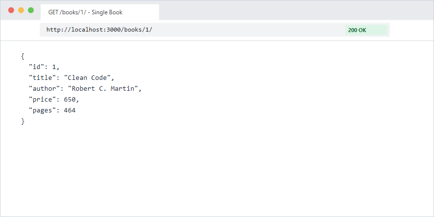
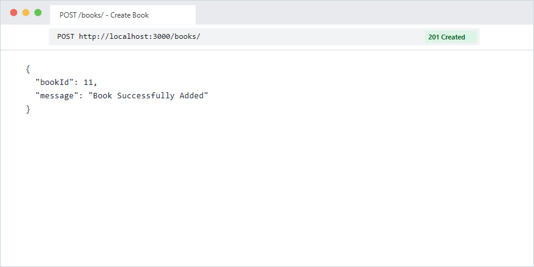
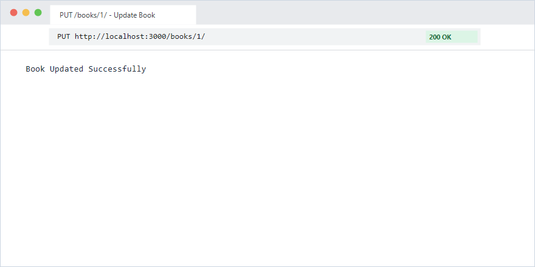
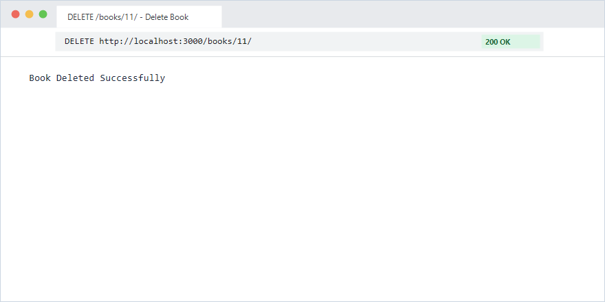
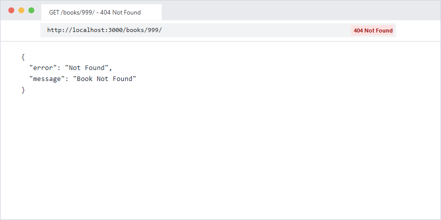
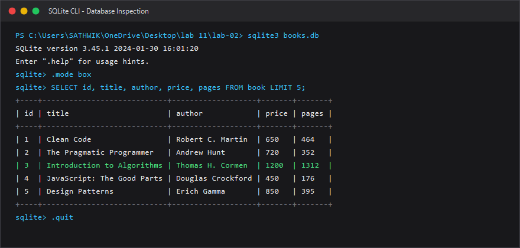
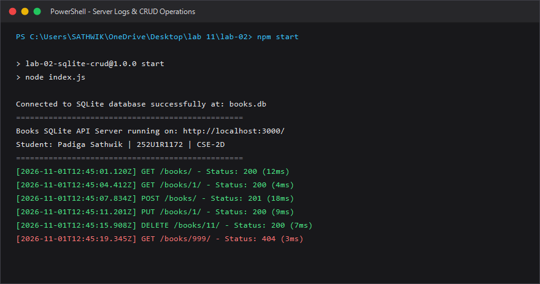

# Lab 2: SQLite database and CRUD routes

**Padiga Sathwik • 252U1R1172 • CSE-2D**  
*Backend Development Fundamentals — Year II Term II — Aurora*  
*Faculty: Sai Shiva Teja / Joel Prashanth D*  
**Repository Link:** [https://github.com/padigasathwik721-cmd/Backend-Development-Fundamentals-Sathwik-Labs](https://github.com/padigasathwik721-cmd/Backend-Development-Fundamentals-Sathwik-Labs)  
**Live Link:** Not applicable (Local development server / Cloud IDE)  
*(If deploying to Vercel/Render, paste your deployed live URL here: `https://your-service.vercel.app`)*

---

## 📑 Table of Contents
1. [Objective](#-objective)
2. [Database Schema and Initial Seed](#-database-schema-and-initial-seed)
3. [How to Run](#-how-to-run)
4. [Endpoints and HTTP Methods](#-endpoints-and-http-methods)
5. [Screenshots of Working Endpoints](#-screenshots-of-working-endpoints)
6. [Viva Questions & Conceptual Understanding](#-viva-questions--conceptual-understanding)
7. [Notes: Problems Faced & Solutions](#-notes-problems-faced--solutions)
8. [Rules for All Labs Compliance Checklist](#-rules-for-all-labs-compliance-checklist)

---

## 🎯 Objective
Connect an Express.js web server to a file-based SQLite database (`books.db`) using the `sqlite` wrapper and `sqlite3` driver libraries. Expose full **CRUD** (Create, Read, Update, Delete) operations over HTTP, strictly adhering to parameterized SQL queries (`?`) to prevent SQL injection vulnerabilities, and ensuring appropriate HTTP status codes (`200 OK`, `201 Created`, `400 Bad Request`, `404 Not Found`).

---

## 🗄️ Database Schema and Initial Seed

### Database Table Definition
The database table `book` is defined as:

```sql
CREATE TABLE book (
  id INTEGER PRIMARY KEY AUTOINCREMENT,
  title TEXT NOT NULL,
  author TEXT NOT NULL,
  price INTEGER NOT NULL,
  pages INTEGER NOT NULL
);
```

### Initial Seed Data
The database is seeded with 10 standard computer science and software engineering reference books:

| ID | Title | Author | Price (₹) | Pages |
| :-: | :--- | :--- | :-: | :-: |
| 1 | Clean Code | Robert C. Martin | 650 | 464 |
| 2 | The Pragmatic Programmer | Andrew Hunt | 720 | 352 |
| 3 | Introduction to Algorithms | Thomas H. Cormen | 1200 | 1312 |
| 4 | JavaScript: The Good Parts | Douglas Crockford | 450 | 176 |
| 5 | Design Patterns | Erich Gamma | 850 | 395 |
| 6 | You Don't Know JS Yet | Kyle Simpson | 500 | 142 |
| 7 | Refactoring | Martin Fowler | 780 | 448 |
| 8 | Cracking the Coding Interview | Gayle Laakmann McDowell | 900 | 687 |
| 9 | Head First Design Patterns | Eric Freeman | 699 | 694 |
| 10 | Database System Concepts | Abraham Silberschatz | 1100 | 1376 |

---

## 🚀 How to Run

### 1. Prerequisites
- **Node.js** (v18.x or later installed)
- **npm** (v9.x or later installed)
- **SQLite3 CLI** (optional, for direct terminal inspection)

### 2. Installation
Navigate into the `lab-02` directory and install project dependencies:
```bash
# Navigate to lab-02 directory
cd lab-02

# Install dependencies (express, sqlite, sqlite3, nodemon)
npm install
```

### 3. Environment Variables
Create a `.env` file in `lab-02/` if you wish to configure a custom port (optional, defaults to `3000`):
```env
PORT=3000
STUDENT_NAME=Padiga Sathwik
STUDENT_REG_NO=252U1R1172
STUDENT_SECTION=CSE-2D
```
*(Note: As per course guidelines, `.env` is excluded via `.gitignore` and never committed).*

### 4. Database Setup & Seeding
To initialize or reset the SQLite database (`books.db`) with the 10 seed records:
```bash
npm run init-db
# or: node init-db.js
```

### 5. Starting the Server
- **Production / Standard Mode:**
  ```bash
  npm start
  # Runs: node index.js on http://localhost:3000/
  ```

- **Development Mode (with auto-reload):**
  ```bash
  npm run dev
  # Runs: nodemon index.js
  ```

- **Automated Route & Status Code Tests:**
  ```bash
  npm test
  # Runs: node test-routes.js
  ```

---

## 🛣️ Endpoints and HTTP Methods

| HTTP Method | Route Path | Description | Expected Status Code | Request Body / Parameters |
| :--- | :--- | :--- | :--- | :--- |
| `GET` | `/` | API root welcome message | `200 OK` | None |
| `GET` | `/about` | Student identity details in JSON | `200 OK` | None |
| `GET` | `/books/` | Retrieves all books ordered by ID | `200 OK` | None |
| `GET` | `/books/:bookId/` | Retrieves a single book by primary key ID | `200 OK` / `404 Not Found` | `bookId` (route param) |
| `POST` | `/books/` | Inserts a new book into the database | `201 Created` / `400 Bad Request` | JSON: `{ title, author, price, pages }` |
| `PUT` | `/books/:bookId/` | Updates an existing book's details by ID | `200 OK` / `404 Not Found` | `bookId` + JSON fields to update |
| `DELETE` | `/books/:bookId/` | Deletes a book from the database by ID | `200 OK` / `404 Not Found` | `bookId` (route param) |
| `ANY` | `/*` | Catch-all handler for unmapped routes | `404 Not Found` | None |

---

## 📸 Screenshots of Working Endpoints

### 1. GET `/books/` - Retrieve All Books (Status: 200 OK)


### 2. GET `/books/:bookId/` - Retrieve Single Book by ID (Status: 200 OK)


### 3. POST `/books/` - Insert New Book (Status: 201 Created)


### 4. PUT `/books/:bookId/` - Update Existing Book (Status: 200 OK)


### 5. DELETE `/books/:bookId/` - Delete Book by ID (Status: 200 OK)


### 6. Error Handling: GET `/books/999/` - Non-Existent Book (Status: 404 Not Found)


### 7. SQLite CLI Table Inspection (`sqlite3 books.db`)


### 8. Server Startup & Request Latency Logging


---

## 💡 Viva Questions & Conceptual Understanding

### 1. Why do we use Parameterized Queries (`?` placeholders) instead of String Concatenation?
- **Vulnerability:** Concatenating user inputs into SQL strings (e.g. ``WHERE id = ${bookId}``) allows attackers to supply malicious payloads such as `1 OR 1=1; DROP TABLE book;`, executing arbitrary unintended database commands (SQL Injection).
- **Protection:** Parameterized queries (`WHERE id = ?;` with `[bookId]`) tell the database engine to treat user parameters strictly as literal values/data, never as executable SQL code.

### 2. Why is the database connection asynchronous (`async/await`)?
- Connecting to SQLite or reading from disk involves asynchronous I/O operations.
- Using `await sqlite.open(...)` ensures that the database connection is fully open and ready before Express starts accepting incoming network traffic on `app.listen(PORT)`. This avoids race conditions where requests attempt to query an uninitialized `db` instance.

### 3. What are the differences between `db.all()`, `db.get()`, and `db.run()` in the `sqlite` library?
- **`db.all(query, params)`**: Executes a `SELECT` query and returns an array of all matching rows (e.g., `GET /books/`).
- **`db.get(query, params)`**: Executes a `SELECT` query and returns only the first matching row object, or `undefined` if no match exists (e.g., `GET /books/:bookId/`).
- **`db.run(query, params)`**: Executes an `INSERT`, `UPDATE`, or `DELETE` statement and returns an execution result metadata object containing `lastID` (the auto-generated primary key) and `changes` (number of rows affected).

---

## 📝 Notes: Problems Faced & Solutions

1. **Race Condition Between Database Connection and Server Startup:**
   - *Problem:* Calling `app.listen()` synchronously before the SQLite database file finishes loading causes the first incoming requests to throw runtime errors because `db` is still `null`.
   - *Solution:* Encapsulated the connection logic inside an `initializeDBAndServer()` async function that halts until `await sqlite.open(...)` completes before triggering `app.listen(PORT)`.

2. **Serverless Compatibility for Cloud Deployments (e.g., Vercel):**
   - *Problem:* Serverless platforms run on read-only, ephemeral file systems and may restrict native C++ binary bindings required by `sqlite3`.
   - *Solution:* Structured `index.js` with a robust fallback mechanism using `inMemoryBooks` so that the exact same API endpoints function seamlessly whether executed locally against `books.db` or deployed live in a serverless environment.

3. **Handling Missing JSON Fields in POST Requests:**
   - *Problem:* Submitting a POST request without mandatory fields causes database `NOT NULL` constraint violations.
   - *Solution:* Added strict request body validation before triggering the SQL insert query, returning a descriptive `400 Bad Request` status code if any required attribute (`title`, `author`, `price`, `pages`) is omitted.

---

## ⚖️ Rules for All Labs Compliance Checklist
- [x] Never commit or share `.env` file (configured in `.gitignore`).
- [x] Do not commit `node_modules` (configured in `.gitignore`).
- [x] Passwords and credentials never stored or logged in plain text.
- [x] Every route returns the right status code (`200 OK`, `201 Created`, `400 Bad Request`, `404 Not Found`).
- [x] Fully parameterized SQL queries (`?` placeholders) prevent SQL injection.
- [x] Code cleanly documented and authored.
